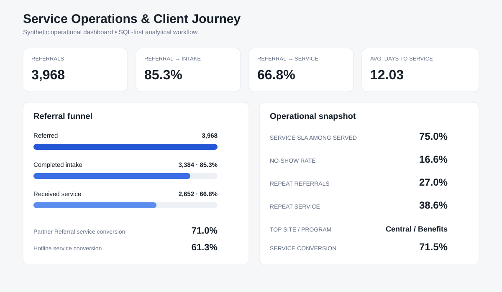

# Service Operations & Client Journey Analytics

[](https://github.com/fernandoverdugo/service-operations-sql-analytics/actions/workflows/quality-checks.yml)

A SQL-first portfolio project that simulates a multi-site public-service organization and analyzes how clients move from referral through intake, appointment, service delivery, and case closure.

## Project snapshot

- **3,000** synthetic clients
- **3,968** referrals
- **6,783** appointments
- **4,127** service events
- **85.3%** referral-to-intake conversion
- **66.8%** referral-to-service conversion
- **12.03 days** average referral-to-service time
- **16.6%** appointment no-show rate
- **18 months** of operational trends
- **15 fully observed** 90-day referral cohorts

[Read the executive summary](docs/EXECUTIVE_SUMMARY.md)

## Technical stack

**SQL · SQLite · Python · pandas · NumPy · pytest · GitHub Actions · HTML/CSS**

## Core question

Where do clients experience delays or drop-off in the service journey, and which operational patterns should managers address first?

## What a hiring manager can see quickly

This repository demonstrates the core workflow expected in many Data Analyst roles:

- query normalized relational data with SQL;
- define and document business KPIs;
- analyze conversion funnels, SLAs, no-shows, cohorts, and trends;
- use window functions for rolling metrics and rankings;
- create reporting marts that separate business logic from presentation;
- translate analysis into management-facing follow-up priorities;
- deliver a validated dashboard and reproducible reporting pipeline.

[View the live dashboard](https://fernandoverdugo.github.io/service-operations-sql-analytics/dashboard.html) · [Read the KPI dictionary](docs/KPI_DICTIONARY.md)

## Why this project

This project is intentionally designed around the work expected of a Data Analyst:

- relational data modeling
- SQL joins
- KPI definition
- funnel analysis
- cohorts
- wait-time and SLA reporting
- no-show analysis
- repeat-service behavior
- window functions
- site and program comparisons
- dashboard-ready marts
- executive reporting

Machine learning is not the centerpiece. The goal is to demonstrate strong operational analytics and stakeholder-facing SQL work.

## Synthetic scenario

A public-service organization operates multiple sites and programs. Clients may be referred, complete intake, schedule appointments, receive services, return for follow-up, and eventually close their cases.

All data are synthetic. No real client, provider, program, or case information is used.

## Milestone 1 — operational scorecard and funnel

**Complete**

Validated synthetic dataset:

| Measure | Result |
| --- | ---: |
| Clients | **3,000** |
| Referrals | **3,968** |
| Cases | **3,384** |
| Appointments | **6,783** |
| Service events | **4,127** |

Key operational results:

- referral-to-intake rate: **85.3%**
- referral-to-service rate: **66.8%**
- average referral-to-service time: **12.03 days**
- no-show rate: **16.6%**
- service SLA rate among served referrals: **75.0%**

[Read the Milestone 1 findings](docs/MILESTONE1_OPERATIONAL_SCORECARD.md)

## Milestone 2 — trends, cohorts, and ranked performance

**Complete**

The SQL layer now includes:

- 18 monthly referral trend periods
- 3-month rolling service-conversion rates
- month-over-month change with `LAG()`
- client-level repeat-referral and repeat-service behavior
- fully observed 90-day referral cohorts
- `ROW_NUMBER()`, `LEAD()`, and `DENSE_RANK()`
- ranked site/program performance

Selected results:

- repeat-referral clients: **27.0%**
- multi-program clients: **20.9%**
- repeat-service clients: **38.6%**
- highest fully observed 90-day repeat cohort: **13.3%**
- lowest fully observed 90-day repeat cohort: **5.2%**

[Read the Milestone 2 findings](docs/MILESTONE2_TRENDS_COHORTS.md)

## Milestone 3 — dashboard marts and stakeholder reporting

**Complete**

The reporting layer now includes three dedicated SQL marts:

- executive KPI mart
- monthly trend mart
- site/program performance mart

The repository also includes a lightweight stakeholder dashboard generated from validated analytical summaries.



**[View the Live Dashboard](https://fernandoverdugo.github.io/service-operations-sql-analytics/dashboard.html)**

[View the dashboard source](docs/dashboard.html)

[Read the Milestone 3 findings](docs/MILESTONE3_DASHBOARD.md)

## Current status

**Portfolio-ready**

The completed analyst workflow is:

```text
synthetic relational data
        ↓
SQLite operational database
        ↓
SQL KPI + funnel analysis
        ↓
monthly trends + cohorts
        ↓
window-function rankings
        ↓
dashboard-ready marts
        ↓
stakeholder dashboard
```

The project intentionally stops here rather than adding machine learning that is not needed for the business question.

Automated GitHub Actions quality checks rebuild the synthetic data and database, regenerate analytical summaries and the dashboard, run validation scripts, execute the pytest suite, and verify repository integrity on pushes and pull requests to `main`.


## Reproduce the analysis

Requires Python 3.14.

```bash
python -m venv .venv
source .venv/bin/activate
python -m pip install -r requirements.txt

python src/generate_synthetic_data.py
python src/build_service_db.py
python src/summarize_milestone1.py
python src/summarize_milestone2.py
python src/build_dashboard.py
python src/validate_dashboard.py
python src/validate_dataset.py

python -m pytest -q
python src/validate_project.py
```

Generated raw and processed data are intentionally excluded from version control. The summary scripts refresh both the working outputs and the committed aggregate summaries under `data/metadata/`, which are the source used to build the stakeholder dashboard.

## Repository structure

```text
config/          synthetic data configuration
data/metadata/   committed aggregate analytical results
docs/            executive summary, milestone reports, dashboard, and figures
sql/             schema, KPI, funnel, cohort, ranking, and dashboard-mart queries
src/             data generation, database build, summaries, dashboard, validation
tests/           smoke and project-quality tests
.github/         automated quality workflow
```

## Documentation

- [Executive Summary](docs/EXECUTIVE_SUMMARY.md)
- [Research Design](docs/RESEARCH_DESIGN.md)
- [KPI Dictionary](docs/KPI_DICTIONARY.md)
- [Milestone 1 — Operational Scorecard & Funnel](docs/MILESTONE1_OPERATIONAL_SCORECARD.md)
- [Milestone 2 — Trends, Cohorts & Ranked Performance](docs/MILESTONE2_TRENDS_COHORTS.md)
- [Milestone 3 — Dashboard Marts & Stakeholder Reporting](docs/MILESTONE3_DASHBOARD.md)
- [Live Dashboard](https://fernandoverdugo.github.io/service-operations-sql-analytics/dashboard.html)
- [Dashboard Source](docs/dashboard.html)

## Responsible use

All data are synthetic. The project evaluates operational performance and service-delivery patterns; it does not model client eligibility, protected-class risk, or automated case decisions.

## License

This project is released under the [MIT License](LICENSE).
